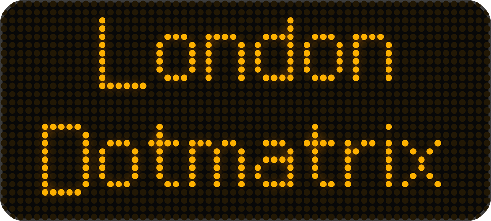
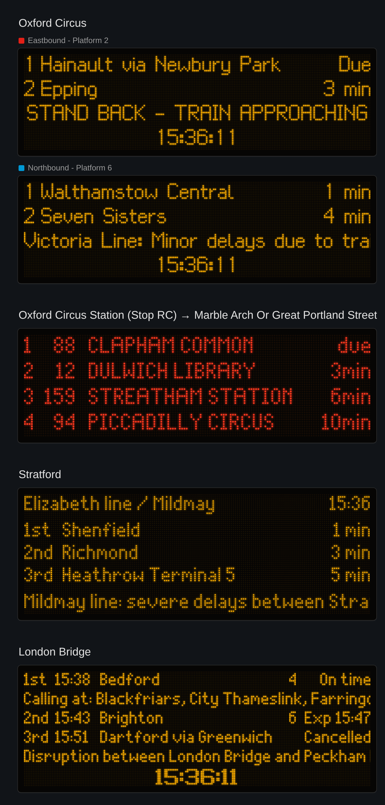
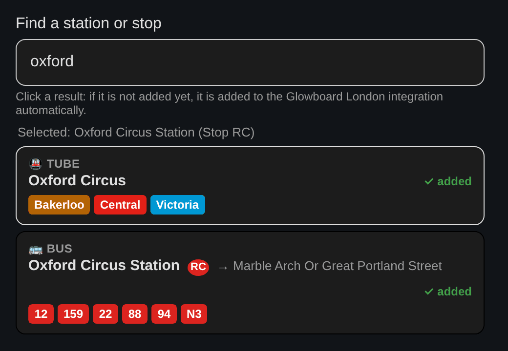
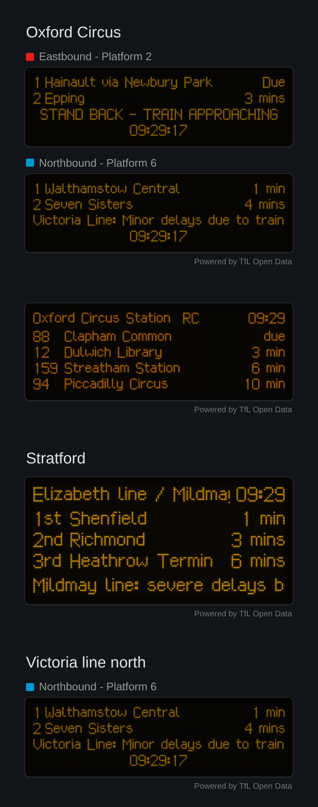

<p align="center"></p>

# London Dotmatrix

**Live London departures in Home Assistant, on dot-matrix boards that look like the real thing.**

Every TfL mode with live predictions: **Tube, buses, DLR, all six Overground lines, Elizabeth line, trams, river buses and the cable car**, plus **National Rail trains from every GB operator** (Thameslink, Southern, c2c, Southeastern, GWR, …). One integration, three dashboard cards:

| Card | Looks like |
|---|---|
| **London Dotmatrix · Tube platform board** | the amber Underground platform indicator: two trains, the third row swiping through later trains, `STAND BACK - TRAIN APPROACHING`, service messages and the clock |
| **London Dotmatrix · Bus stop Countdown** | the red bus stop Countdown sign: `1  31  CAMDEN TOWN  due`, `3 328  GOLDERS GREEN  2min` |
| **London Dotmatrix · Rail departure board** | a station departure board for the DLR, Overground, Elizabeth line, trams, piers, the cable car and **National Rail** stations: `1st 10:32 Brighton  6  Exp 10:38`, calling points scrolling under the first train, station messages and the clock |



> Unofficial project, not affiliated with or endorsed by Transport for London or National Rail. Powered by TfL Open Data and National Rail Enquiries.

## Contents

- [Features](#features)
- [Install with HACS](#install-with-hacs)
- [Set up](#set-up)
- [API keys: where to get them](#api-keys-where-to-get-them)
- [Add the cards](#add-the-cards)
- [Card options](#card-options)
- [Sensors](#sensors)
- [FAQ](#faq)

## Features

- ✅ **Works without an API key** for TfL: try it in 2 minutes; add a free TfL app key later for a much higher rate limit
- ✅ **National Rail too**: add a free Rail Data Marketplace key and search any GB station (name or CRS code, e.g. *London Bridge* or *LBG*)
- ✅ **Live search while you type** in the card editor, with coloured line badges, stop letters and direction; one click adds the stop
- ✅ **Each card finds its own stops**: the Tube card only Tube stations, the bus card only bus stops, the rail card the DLR, Overground, Elizabeth line, tram stops, piers, the cable car and National Rail stations
- ✅ **Interchanges are split up**: search "Stratford" and pick the Tube, the Elizabeth line / Overground station, the DLR or any bus stop
- ✅ **One board per platform** on the Tube card (or pick one platform or one direction, e.g. *Northbound*)
- ✅ **Disruption messages** from TfL line status scroll on the board
- ✅ **Light on your Home Assistant**: no animation loop; the board only redraws when something changes, and stops completely when it is off screen or the tab is hidden
- ✅ **The departure list is not written to the recorder database**
- ✅ The real London Underground dot-matrix typeface, rendered LED by LED

## Install with HACS

1. **HACS → ⋮ (top right) → Custom repositories**
2. Repository: `https://github.com/szbence7/ha-london-dotmatrix`, type: **Integration** → **Add**
3. Search for **London Dotmatrix** → **Download**
4. **Restart Home Assistant** (Settings → System → Restart)

The three cards come with the integration: no separate frontend download. The card resource is added to your dashboards automatically.

## Set up

**Settings → Devices & services → Add integration → London Dotmatrix**

### 1/2 · Data sources

Two optional keys (see [where to get them](#api-keys-where-to-get-them)):

- **TfL app key**: can stay empty. Without it TfL only allows a few requests per minute, fine for one or two stops.
- **National Rail key**: only needed for National Rail trains. Without it the integration shows TfL services only.

Keys are stored only in your Home Assistant. Add, change or remove them later: **London Dotmatrix → ⋮ → Reconfigure**.

### 2/2 · Stops

- **A) Easiest: later, in the card editor ⭐** Pick *Later, from the card editor*, add a Dotmatrix card to your dashboard and start typing a station or stop name. Results appear while you type; click one and it is added.
- **B) Right now:** pick *Search for a stop now*, type a name, tick one or more stops.

Every stop becomes a device with one sensor.



### Later

| What | How |
|---|---|
| Add a stop | from any card editor, or **+ Add stop** on the integration page |
| Remove a stop | ⋮ on the stop's row → **Delete** |
| Update interval, departures kept | the ⚙️ cog on the integration |
| API keys | ⋮ → **Reconfigure** |

## API keys: where to get them

Both are free.

### TfL app key (Tube, buses, DLR, Overground, Elizabeth line, trams, river buses)

1. Open [api-portal.tfl.gov.uk](https://api-portal.tfl.gov.uk) and **Sign up** (email and password), then confirm your email
2. **Products** → subscribe to **500 Requests per min**
3. **Profile** → copy the **Primary key**
4. Paste it into the **TfL app key** field

### National Rail key (Thameslink, Southern, c2c, Southeastern, GWR and every other GB operator)

The data is National Rail's Darwin *Live Departure Board*, distributed by the Rail Data Marketplace.

1. Open [raildata.org.uk](https://raildata.org.uk) → **Register**, choose *individual not affiliated with a company*, confirm your email and set up two-factor sign-in
2. Search the data catalogue for **Live Departure Board** (the Darwin LDBWS product) and **Subscribe**
3. When the subscription is approved, open it → **Specification** tab → copy the **Consumer key**
4. Paste it into the **National Rail key** field

Then search for a station by name or CRS code (e.g. *London Bridge* or *LBG*) in the rail card editor.

## Add the cards

**Which card?** The **Tube** card copies the Underground platform indicator: one board per platform, trains numbered 1, 2, the third row swipes through later trains or shows STAND BACK, and the clock ticks at the bottom. The **rail** card is a station departure board: a header with the platform or line and the time, then as many `1st / 2nd / 3rd` rows as you like, one board for the whole station by default. The **bus** card is the Countdown sign at the stop.

Edit your dashboard → **Add card** → search for **Dotmatrix**. Choose a card, search for the stop in the editor, done.

On Home Assistant 2026.6 or newer you can also start from the stop: **Add card → By entity**, pick a stop sensor, and the matching Dotmatrix card is offered in the **Community** suggestions.

```yaml
type: custom:dotmatrix-tube-card
entity: sensor.oxford_circus_next_arrival
platform: Northbound        # optional: one platform, or a direction
```

```yaml
type: custom:dotmatrix-bus-card
entity: sensor.oxford_circus_station_stop_rc_next_arrival
rows: 4
```

```yaml
type: custom:dotmatrix-rail-card
entity: sensor.stratford_next_arrival
lines: [elizabeth]
group_by_platform: true
```

On phones the boards shrink their LEDs to keep a full line visible:



## Card options

All options are in the visual editor; the YAML names are below.

| Option | Cards | Default | What it does |
|---|---|---|---|
| `entity` | all | | the stop's sensor |
| `title` | all | stop name | text above the board |
| `platform` | tube, rail | every platform | exact platform (`Eastbound - Platform 2`) or part of it (`Eastbound`, `Platform 5`) |
| `lines` | all | all | only these lines / routes / train operators, e.g. `[central]`, `["25", "n25"]`, `[tl]` (Thameslink) |
| `color` | all | amber | LED colour (any hex colour) |
| `rows` | bus, rail | 4 / 3 | departures on the board |
| `max_boards` | tube, rail | 4 | most boards shown (one per platform) |
| `stand_back` | tube | `true` | `STAND BACK - TRAIN APPROACHING` when the next train is due |
| `show_status` | all | `true` (bus: `false`) | scroll TfL disruption messages |
| `show_clock` | all | `true` | clock (always London time) |
| `show_platform` | tube | `true` | platform caption above each board |
| `show_header` | bus, rail | `true` | header row on the board |
| `group_by_platform` | rail | `false` | one board per platform |
| `show_line` | rail | `false` | line / operator name on every row |
| `show_calling_at` | rail | `true` | National Rail: calling points scrolling under the first train |
| `header` | rail | platform or line | custom header text |
| `scroll_speed` | all | 22 | dots per second for long texts |
| `columns` | all | automatic | LEDs per row (fixed resolution) |
| `dot_shape` | all | round (bus: square) | `round` or `square` LEDs |
| `background` | all | `true` | black board with a bezel |
| `show_attribution` | all | `false` | a small *Powered by TfL Open Data* / *Powered by National Rail Enquiries* line under the board |

## Sensors

One sensor per stop, e.g. `sensor.oxford_circus_next_arrival`

- **State:** minutes until the next arrival
- **Attributes:** the whole board

```yaml
stop_id: 940GZZLUOXC
stop_name: Oxford Circus
letter: ""            # bus stop letter, e.g. RC
towards: ""           # bus stop direction
modes: [tube]
departures:
  - line: central
    line_name: Central
    mode: tube
    destination: Hainault via Newbury Park
    platform: Eastbound - Platform 2
    direction: outbound
    expected: 1794300030   # unix time
    minutes: 0
    color: "#E32017"
line_status:
  - line: victoria
    severity: 9
    description: Minor Delays
    reason: "Victoria Line: Minor delays due to train cancellations."
```

Automation idea: a notification when your bus is 5 minutes away.

```yaml
trigger:
  - platform: numeric_state
    entity_id: sensor.oxford_circus_station_stop_rc_next_arrival
    below: 6
action:
  - action: notify.mobile_app_my_phone
    data:
      message: >
        
        {{ d.line_name }} to {{ d.destination }} in {{ states(trigger.entity_id) }} min
```

## FAQ

**"Cannot reach TfL / rate limit".** Without an app key TfL allows only a few requests per minute. Add a free key (see above) or raise the update interval.

**National Rail stations don't show up in the search.** Add your National Rail key first (⋮ → Reconfigure). National Rail stations appear in the **rail** card's search only.

**"National Rail rejected this key".** Use the *Consumer key* of your **Live Departure Board** subscription, and wait until the subscription is approved. Keys from the old OpenLDBWS (SOAP) registration do not work here.

**I can't find my bus stop.** Type the stop name as written on the stop (e.g. *Brixton Station*) and look for the right letter and direction. Bus stations expand into all their stops.

**My platform shows "Departures" or no platform.** Some stations (mostly Overground and Elizabeth line) do not always send a platform. Use the rail card without `group_by_platform`.

**How much does it load TfL and HA?** One request per stop per update (30 s by default), plus line status at most every 2 minutes, shared by all stops. On the dashboard each card redraws only when its content changes.

## Credits

- Data: [TfL Unified API](https://api.tfl.gov.uk). Powered by TfL Open Data. Contains OS data © Crown copyright and database rights.
- National Rail data: Darwin Live Departure Board via the [Rail Data Marketplace](https://raildata.org.uk). Powered by National Rail Enquiries.
- Station list: [uk-railway-stations](https://github.com/davwheat/uk-railway-stations) by David Wheatley, based on [Trainline EU stations](https://github.com/trainline-eu/stations), Open Database License ([licence](custom_components/london_dotmatrix/data/LICENSE-ODbL.txt)).
- Typefaces (SIL Open Font License 1.1, rendered into LED bitmaps, see [frontend/fonts](frontend/fonts/README.md)): [London Underground dot-matrix typeface](https://github.com/petykowski/London-Underground-Dot-Matrix-Typeface) by petykowski (Tube boards) and [Dot Matrix Typeface](https://github.com/DanielHartUK/Dot-Matrix-Typeface) by Daniel Hart (station boards, bus Countdown).
- Not affiliated with Transport for London. "Underground" and "Overground" are used only to describe the services.

## Development

```bash
npm install
npm run font    # only if the typeface changes (needs Playwright)
npm run build   # frontend/src -> custom_components/london_dotmatrix/www/dotmatrix-cards.js
npm test        # card logic
pip install pytest-homeassistant-custom-component && pytest   # integration
```

## Support

If it saves you a sprint for the train, you can buy me a coffee. Thank you! ☕

<a href="https://www.buymeacoffee.com/benceix"></a>
